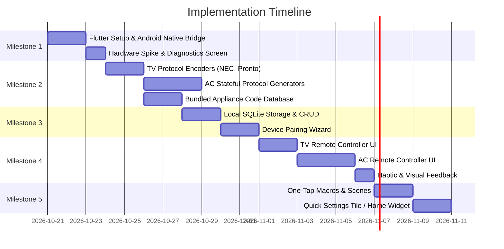

# Universal IR Remote — Architecture & Implementation Plan

> **Target Device:** Xiaomi Redmi 4X (*santoni* — Qualcomm Snapdragon 435, Consumer IR Blaster)  
> **Tech Stack:** Flutter (Dart) + Native Android Platform Channel (Kotlin)  
> **Architecture:** Clean Architecture + Layered MVVM (Model-View-ViewModel)

---

## 1. Executive Summary & Hardware Context

The goal is to turn a **Redmi 4X** smartphone into a responsive, offline-first universal remote control for home appliances, focusing primarily on **Televisions (TV)** and **Air Conditioners (AC)**.

### 1.1 Hardware Characteristics & Constraints
- **IR Blaster:** The Redmi 4X features an infrared transmitter managed by Android's `android.hardware.ConsumerIrManager` (API level 19+).
- **No IR Receiver:** The phone lacks an IR photodiode receiver. It **cannot** "learn" codes by pointing another remote at the phone. All codes must be generated algorithmically or loaded from a pre-compiled offline database.
- **Carrier Frequencies:** Consumer IR typically modulates signals at carrier frequencies between **36 kHz and 56 kHz** (standard consumer appliances use **38 kHz**).

### 1.2 Protocol Divergence: TV vs. Air Conditioner

```
┌────────────────────────────────────────────────────────────────────────┐
│                        Appliance IR Protocol Gap                       │
├───────────────────────────────────┬────────────────────────────────────┤
│           Television              │          Air Conditioner           │
├───────────────────────────────────┼────────────────────────────────────┤
│ • Stateless                       │ • Stateful                         │
│ • Single fixed burst (12–32 bits) │ • Full-state frame (100–300 pulses)│
│ • "Vol+" sends only Vol+ command  │ • "25°C" sends: Temp+Mode+Fan+Swing│
│ • Protocol: NEC, RC5, Sony SIRC   │ • Protocol: Daikin, Gree, Midea    │
│ • Easy to store as raw hex/pulses │ • Requires dynamic frame encoder   │
└───────────────────────────────────┴────────────────────────────────────┘
```

---

## 2. System Architecture

The project follows a **Layered Clean Architecture** combined with the **MVVM** pattern in the UI layer.

```mermaid
flowchart TD
    subgraph UI_Layer["UI Layer (Presentation)"]
        Views["Views (Stateless / Dumb Widgets)<br/>• DeviceListView<br/>• TvRemoteView<br/>• AcRemoteView<br/>• PairingWizardView"]
        VMs["ViewModels (ChangeNotifier)<br/>• DeviceListViewModel<br/>• TvRemoteViewModel<br/>• AcRemoteViewModel<br/>• PairingWizardViewModel"]
        Views -->|User Interaction| VMs
        VMs -->|ListenableBuilder / Notify| Views
    end

    subgraph Domain_Layer["Domain Layer (Core Business Logic)"]
        UC["Use Cases<br/>• TransmitCommandUseCase<br/>• TransmitAcStateUseCase<br/>• PairDeviceUseCase"]
        Encoders["Protocol Encoders (Strategy Pattern)<br/>• NecProtocolEncoder<br/>• ProntoHexEncoder<br/>• DaikinAcEncoder<br/>• GreeAcEncoder<br/>• PanasonicAcEncoder"]
        VMs --> UC
        UC --> Encoders
    end

    subgraph Data_Layer["Data Layer (Repositories & Services)"]
        Repo["Repositories<br/>• DeviceRepository<br/>• ApplianceCodeRepository"]
        LocalDB["Local Storage Service<br/>(SQLite / Sqflite)"]
        AssetDB["Asset Database Service<br/>(Bundled JSON Code Sets)"]
        IRService["ConsumerIrService<br/>(Flutter MethodChannel Bridge)"]
        
        UC --> Repo
        Repo --> LocalDB
        Repo --> AssetDB
        UC --> IRService
    end

    subgraph Platform_Layer["Android Platform Layer (Kotlin)"]
        Channel["MethodChannel: 'universal_remote/ir'"]
        CIM["android.hardware.ConsumerIrManager"]
        Hardware["Redmi 4X IR Transmitter LED"]

        IRService -->|transmit(freq, pattern)| Channel
        Channel --> CIM
        CIM --> Hardware
    end
```

---

## 3. Design Patterns Applied

### 3.1 Strategy Pattern (`IrProtocolEncoder`)
Because each manufacturer and appliance type uses different encoding specifications, we define an abstract `IrProtocolEncoder` strategy:

```dart
abstract class IrProtocolEncoder {
  /// Encodes high-level commands into alternating mark/space microsecond intervals
  IrPacket encodeCommand(String commandCode, {Map<String, dynamic>? parameters});
}
```
Concrete strategies:
- `NecProtocolEncoder`: Standard 38kHz NEC pulses (9ms header, 4.5ms space, 560µs bit-0, 1690µs bit-1).
- `ProntoHexEncoder`: Parses universal Pronto hex strings into frequency and microsecond pulse arrays.
- `DaikinAcEncoder`, `GreeAcEncoder`, `MideaAcEncoder`: Dynamic frame builders computing byte arrays, bitwise parity/checksums, and carrier modulation.

### 3.2 State Pattern (`AcState`)
Air conditioners require state synchronization:
```dart
class AcState {
  final bool isPowerOn;
  final int targetTemperature; // 16 - 30 °C
  final AcMode mode;          // cool, heat, fan, dry, auto
  final AcFanSpeed fanSpeed;  // auto, low, med, high, turbo
  final bool swingVertical;
  final bool swingHorizontal;

  AcState copyWith({ ... });
}
```

### 3.3 Adapter Pattern (`ConsumerIrService`)
Adapts Android's raw `ConsumerIrManager` platform APIs into type-safe Dart primitives:
- `Future<bool> hasIrEmitter()`
- `Future<List<CarrierFrequencyRange>> getCarrierFrequencies()`
- `Future<void> transmit({required int frequency, required List<int> pattern})`

---

## 4. Project Directory Structure

```text
universal-remote/
├── android/
│   └── app/src/main/kotlin/com/example/universal_remote/
│       ├── MainActivity.kt                 # MethodChannel handler
│       └── ir/
│           └── ConsumerIrBridge.kt         # Wrapper around ConsumerIrManager
├── assets/
│   └── ir_db/
│       ├── tv_codesets.json                # Pre-defined TV codes (Sony, Samsung, LG, TCL)
│       └── ac_definitions.json             # AC brand protocol identifiers
├── lib/
│   ├── data/
│   │   ├── datasources/
│   │   │   ├── local_database.dart         # SQLite / Sqflite tables for devices & rooms
│   │   │   └── asset_code_datasource.dart  # Bundled JSON loader
│   │   ├── models/
│   │   │   ├── device_dto.dart
│   │   │   └── code_set_dto.dart
│   │   ├── repositories/
│   │   │   ├── device_repository_impl.dart
│   │   │   └── code_repository_impl.dart
│   │   └── services/
│   │       └── consumer_ir_service.dart    # MethodChannel implementation
│   ├── domain/
│   │   ├── models/
│   │   │   ├── appliance_type.dart         # enum { tv, ac, fan }
│   │   │   ├── device_entity.dart
│   │   │   ├── room_entity.dart
│   │   │   ├── ac_state.dart
│   │   │   └── ir_packet.dart
│   │   ├── encoders/
│   │   │   ├── ir_protocol_encoder.dart
│   │   │   ├── nec_encoder.dart
│   │   │   ├── pronto_hex_encoder.dart
│   │   │   └── ac/
│   │   │       ├── ac_encoder_base.dart
│   │   │       ├── daikin_encoder.dart
│   │   │       ├── gree_encoder.dart
│   │   │       └── panasonic_encoder.dart
│   │   └── use_cases/
│   │       ├── transmit_ir_command_use_case.dart
│   │       ├── transmit_ac_state_use_case.dart
│   │       └── manage_devices_use_case.dart
│   ├── ui/
│   │   ├── core/
│   │   │   ├── theme/
│   │   │   │   ├── app_colors.dart
│   │   │   │   └── app_theme.dart
│   │   │   └── widgets/
│   │   │       ├── tactile_button.dart     # Haptic feedback button
│   │   │       ├── d_pad.dart              # Directional pad for TVs
│   │   │       └── rocker_switch.dart      # Volume / Channel rocker
│   │   └── features/
│   │       ├── home/
│   │       │   ├── view_models/home_view_model.dart
│   │       │   └── views/home_view.dart
│   │       ├── pairing/
│   │       │   ├── view_models/pairing_view_model.dart
│   │       │   └── views/pairing_wizard_view.dart
│   │       ├── tv_remote/
│   │       │   ├── view_models/tv_remote_view_model.dart
│   │       │   └── views/tv_remote_view.dart
│   │       ├── ac_remote/
│   │       │   ├── view_models/ac_remote_view_model.dart
│   │       │   └── views/ac_remote_view.dart
│   │       └── diagnostics/
│   │           ├── view_models/diagnostics_view_model.dart
│   │           └── views/diagnostics_view.dart
│   └── main.dart
└── pubspec.yaml
```

---

## Status (2026-10-20): air conditioners first

Milestone 1 is done. Priorities changed to an AC-first vertical slice, which is now in place:

- **AC encoders** (`lib/domain/encoders/ac/`), each checked byte-for-byte against IRremoteESP8266 test vectors:
  Daikin (280-bit), Panasonic (DKE, JKE), LG (LG2, LG), Electra (Casper, AUX, Electrolux), Samsung, Toshiba,
  Mitsubishi Electric, Gree (YAW1F, YBOFB), Coolix (Midea-made units), Midea. Electra is also verified against 727
  real Casper SC-09FS32 captures (SmartIR `codes/climate/3240.json`) and uses the Casper remote's timings. Toggle-style settings (Midea/Coolix swing and turbo, LG swing, Toshiba swing)
  are sent by comparing with the previous state.
- **Auto find** (`AcCodeSearch` + pairing wizard): IR is one-way and the Redmi 4X has no receiver, so the app sends
  "Power on, Cool, 25 °C" with each candidate code (the brand's known codes first, then all others) and the user
  confirms the beep; auto mode advances every 4 s; a Power-off check confirms the match.
- **Brand suggestions**: `assets/ir_db/ac_brands.json` ranks brands common in Vietnam and maps each to its codes.
  Casper maps to Electra first.
- **Sending** (`AcSendQueue`, `IrSendLog`): every paired-AC send goes through one queue: one transmission at a time
  across all ACs, taps during a send merged into one pending state, each frame encoded against the state the AC last
  received (so toggle commands go out once), and the delivered state saved. On Android, `ConsumerIrBridge` runs the
  synchronous `ConsumerIrManager.transmit` on its own thread, never on the main thread. Diagnostics shows the last 50
  transmissions (frames, timings, errors) with Copy for bug reports.
- **Storage**: paired ACs and their last state in shared preferences (`AcDeviceRepository`, writes serialized, partial
  `update` for state and name); SQLite is no longer needed for this slice.
- **UI**: Home (device cards with one-tap power), Find-my-AC wizard, AC remote (dial, modes, fan, airflow);
  Diagnostics moved to the Home menu.
- **TV**: Samsung32, Sony SIRC, Panasonic (Kaseikyo) and Pronto encoders plus `tv_codesets.json` (IRDB) are ready
  for the TV milestone; the TV screens are not built yet.

## 5. Detailed Implementation Plan & Milestones



### Milestone 1: Hardware Spike & Native Platform Bridge
- **Deliverables:**
  - Create Flutter project skeleton.
  - Configure `AndroidManifest.xml` with `android.permission.TRANSMIT_IR` and `android.hardware.consumerir` feature check.
  - Implement Kotlin `MethodChannel` communicating with `ConsumerIrManager`.
  - Diagnostics screen displaying:
    - IR Blaster presence (`hasIrEmitter`).
    - Supported carrier frequency ranges.
    - Test button transmitting a standard 38kHz NEC burst (Samsung/LG Power toggle) to verify hardware LED flashes.

### Milestone 2: Protocol Engines & Offline Database
- **Deliverables:**
  - `IrPacket` structure (`int frequency, List<int> pattern`).
  - `NecProtocolEncoder`: Encodes 32-bit hex address + command into microsecond pulse intervals.
  - `ProntoHexEncoder`: Converts raw Pronto Hex code strings to microsecond pulse timings.
  - `AcProtocolEncoder` suite:
    - Base stateful encoder with checksum calculation.
    - Implementations for popular AC brands (Daikin, Panasonic, Gree, Midea).
  - Bundled JSON dataset containing top TV brands and candidate code sets.

### Milestone 3: Room & Device Management + Pairing Wizard
- **Deliverables:**
  - SQLite database schema (`rooms`, `devices`, `custom_buttons`).
  - Device Repository for saving, renaming, and deleting devices.
  - **Interactive Pairing Wizard:**
    - Step 1: Select Type (TV vs AC).
    - Step 2: Select Brand.
    - Step 3: Interactive code tester ("Press Test Power. Did your TV turn off?").
    - Step 4: Confirm and assign to a Room.

### Milestone 4: Dedicated Control Interfaces (TV & AC)
- **Deliverables:**
  - **TV Controller:**
    - Full D-Pad (Up, Down, Left, Right, OK, Back, Home).
    - Rocker switches for Volume (`Vol+` / `Vol-`) and Channel (`Ch+` / `Ch-`).
    - Dedicated Power, Mute, Source, and numeric keypad overlay.
  - **AC Controller:**
    - Circular or stepper temperature controls with live temperature readout.
    - Mode selector tabs (`Cool`, `Dry`, `Fan`, `Heat`, `Auto`).
    - Fan speed toggle (`Auto`, `Low`, `Mid`, `High`, `Turbo`).
    - Swing toggles (`Vertical`, `Horizontal`).
  - Haptic feedback integration (`HapticFeedback.lightImpact()`) on every button press.

### Milestone 5: Macros, Quick Access & Polish
- **Deliverables:**
  - **Macros / Scenes:** Sequence execution (e.g. "Leave Home": Turn off TV, Turn off AC with 500ms delay between IR bursts).
  - **Android Quick Settings Tile:** Quick toggle for primary devices directly from the notification shade.
  - **Export / Import:** Backup configuration to JSON.

---

## 6. Verification & Quality Assurance Strategy

1. **Protocol Unit Tests:**
   - Verify that `NecProtocolEncoder` produces exactly 67 pulses (1 lead-in mark/space, 32 bit pairs, 1 stop bit).
   - Verify AC checksum algorithms against known reference frames from `IRremoteESP8266`.
2. **Hardware Validation:**
   - Use a smartphone camera (front-facing or non-IR-filtered camera) or an oscilloscope / IR photodiode to visually confirm the Redmi 4X IR blaster LED pulses.
3. **Database Integrity:**
   - Validate JSON database schema and ensure all standard buttons (`power`, `vol_up`, `vol_down`, `ch_up`, `ch_down`, `mute`) have valid definitions.
